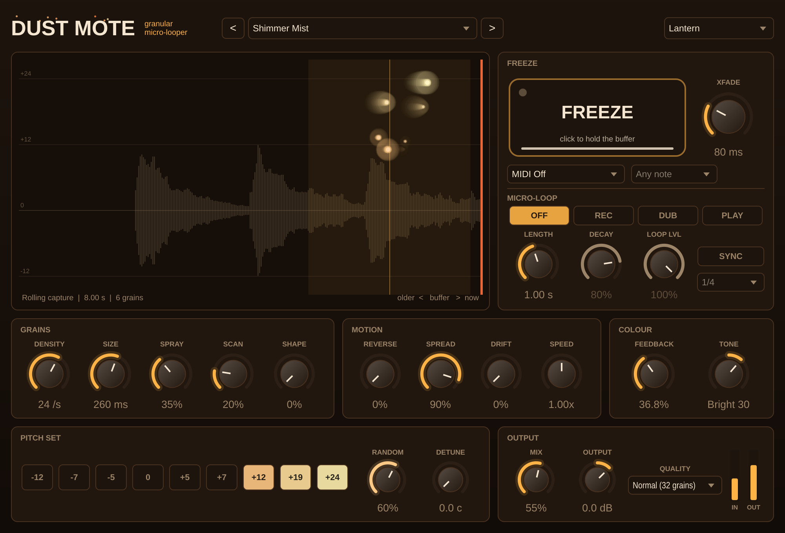

# Dust Mote

A granular micro-looper and cloud generator (VST3 + AU + standalone). It records your guitar or
synth into a rolling 16-second buffer and scatters it into pitch-shifted, reversed micro-grains:
shimmering clouds, stuttering micro-loops and frozen drones. The **Freeze** latch stops recording
so you can hold a chord as a drone and play over it. MIDI can toggle or hold Freeze. See `docs/DESIGN.md`.



## Build

```
cmake -B build -DCMAKE_BUILD_TYPE=Release            # fetches JUCE 8.0.4
# or: cmake -B build -DJUCE_DIR=/path/to/JUCE
cmake --build build --config Release
ctest --test-dir build                                # engine tests
```

macOS builds target macOS 11+ universal (Intel + Apple Silicon) and add the AU format. No AVX2
or other `-march` flags are used; the DSP is scalar C++. Windows builds use the static runtime.
GitHub Actions builds a macOS `.pkg` and a Windows `Setup.exe`, and publishes both to a GitHub
Release when a `v*` tag is pushed.

Layout: `Source/engine` is plain C++ (capture buffer, micro-looper, Freeze, grain scheduler,
presets) with tests in `tests/`. `Source/plugin` is the JUCE wrapper, UI and themes.
`tools/Snapshots.cpp` renders the screenshots in `docs/screenshots` (`-DDUSTMOTE_BUILD_TOOLS=ON`,
needs a display or `xvfb-run` on Linux).
